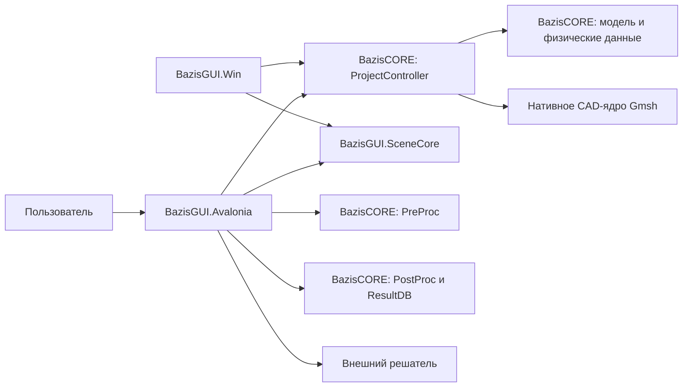

# Архитектура BazisGUI

Этот документ описывает текущие границы проектов решения [BazisGUI.sln](../BazisGUI.sln). Основной клиент — `BazisGUI.Avalonia`; `BazisGUI.Win` остаётся прежней оболочкой. Зависимости от инженерных данных и алгоритмов предоставляются BazisCORE.

## Компоненты

| Проект | Ответственность | Связи |
| --- | --- | --- |
| `BazisGUI.Avalonia` | Окно, навигатор, свойства, диалоги, проектные команды и поверхность сцены | Использует `BazisGUI.SceneCore`, пакеты BazisCORE и внешнего решателя |
| `BazisGUI.SceneCore` | Камера, отрисовка, ввод, геометрический выбор и слои сцены | Не зависит от `Model`; получает координаты через собственный тип `Set` |
| `BazisGUI.Win` | Прежняя оболочка Windows | Использует тот же `BazisGUI.SceneCore`; дальнейшая разработка GUI сосредоточена в `BazisGUI.Avalonia` |
| `BazisGUI.Avalonia.Tests`, `BazisGUI.SceneCore.Tests`, `BazisGUI.Win.Tests` | Проверка соответствующих частей решения | Ссылаются на проверяемые проекты |
| `BazisGUI.MasterInterface`, `UserControlsEx`, `ProjectConverter`, `InstallerAction`, `Setup` | Вспомогательные проекты решения | Состав и зависимости задаются файлами проектов |

Стрелка на схеме означает вызов или использование компонента, а не наследование.

## Путь данных сцены

`ProjectController` предоставляет наборы модели и данные представления. [SceneProjectPresenter](../BazisGUI.Avalonia/Scene/SceneProjectPresenter.cs) строит графические буферы из видимых данных. [SceneSurface](../BazisGUI.Avalonia/Scene/SceneSurface.cs) содержит контроллер сцены и выполняет действия, меняющие OpenGL-состояние, в очереди рендера. Камера, слои и отрисовка находятся в `BazisGUI.SceneCore`.

Выбор объекта начинается с события ввода в `SceneSurface`. [SceneSelection](../BazisGUI.Avalonia/Scene/SceneSelection.cs) лениво формирует `IEnumerable<Set>` и пропускает невидимые объекты. [ScenePicker](../BazisGUI.SceneCore/Core/Picking/ScenePicker.cs) проецирует координаты, проверяет попадание, а для выбора точкой сравнивает глубину. После этого GUI применяет найденные номера к проекту. `Set` содержит имя набора, вид геометрии и перечисление объектов с номерами и координатами ([Set.cs](../BazisGUI.SceneCore/Core/Picking/Set.cs)).

## Путь расчёта и результатов

Оболочка сохраняет проект, вызывает `PreProc` для формирования инструкций и запускает внешний процесс по пути из настроек ([StartStopConp.cs](../BazisGUI.Avalonia/Shell/Methods/Comp/StartStopConp.cs)). Просмотр результатов читает базу через `ResultDB`, создаёт фигуры полей средствами постпроцессора и передаёт их в сцену ([ResultsMainMenuEvents.cs](../BazisGUI.Avalonia/Shell/Methods/Results/ResultsMainMenuEvents.cs)). Численный расчёт не выполняется внутри `BazisGUI.SceneCore` или GUI.

## Платформы и ограничения

`BazisGUI.Avalonia` и `BazisGUI.SceneCore` ориентированы на .NET 8; `BazisGUI.Win` — на `net8.0-windows` ([BazisGUI.Avalonia.csproj](../BazisGUI.Avalonia/BazisGUI.Avalonia.csproj), [BazisGUI.SceneCore.csproj](../BazisGUI.SceneCore/BazisGUI.SceneCore.csproj), [BazisGUI.Win.csproj](../BazisGUI.Win/BazisGUI.Win.csproj)). [Program.cs](../BazisGUI.Avalonia/Program.cs) выбирает WGL на Windows и GLX/EGL на Linux, запрашивая совместимый профиль OpenGL. Фактический запуск CAD и расчётов также зависит от нативного Gmsh, графического окружения, пакетов CORE и настроенного решателя. Поддержка macOS этим документом не подтверждается.
