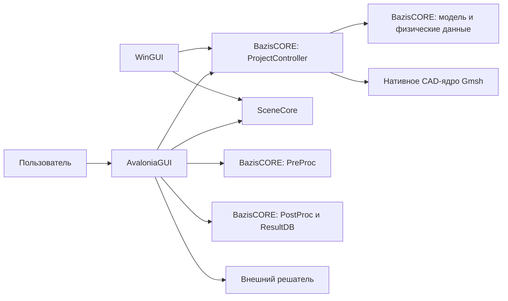

# Архитектура BazisGUI

Этот документ описывает текущие границы проектов решения [BazisGUI.sln](../BazisGUI.sln). Основной клиент — `AvaloniaGUI`; `WinGUI` остаётся прежней оболочкой. Зависимости от инженерных данных и алгоритмов предоставляются BazisCORE.

## Компоненты

| Проект | Ответственность | Связи |
| --- | --- | --- |
| `AvaloniaGUI` | Окно, навигатор, свойства, диалоги, проектные команды и поверхность сцены | Использует `SceneCore`, пакеты BazisCORE и внешнего решателя |
| `SceneCore` | Камера, отрисовка, ввод, геометрический выбор и слои сцены | Не зависит от `Model`; получает координаты через собственный тип `Set` |
| `WinGUI` | Прежняя оболочка Windows | Использует тот же `SceneCore`; дальнейшая разработка GUI сосредоточена в `AvaloniaGUI` |
| `AvaloniaGUI.Tests`, `SceneCore.Tests`, `WinGUI.Tests` | Проверка соответствующих частей решения | Ссылаются на проверяемые проекты |
| `MasterInterface`, `UserControlsEx`, `ProjectConverter`, `InstallerAction`, `Setup` | Вспомогательные проекты решения | Состав и зависимости задаются файлами проектов |

Стрелка на схеме означает вызов или использование компонента, а не наследование.

## Путь данных сцены

`ProjectController` предоставляет наборы модели и данные представления. [SceneProjectPresenter](../AvaloniaGUI/Scene/SceneProjectPresenter.cs) строит графические буферы из видимых данных. [SceneSurface](../AvaloniaGUI/Scene/SceneSurface.cs) содержит контроллер сцены и выполняет действия, меняющие OpenGL-состояние, в очереди рендера. Камера, слои и отрисовка находятся в `SceneCore`.

Выбор объекта начинается с события ввода в `SceneSurface`. [SceneSelection](../AvaloniaGUI/Scene/SceneSelection.cs) лениво формирует `IEnumerable<Set>` и пропускает невидимые объекты. [ScenePicker](../SceneCore/Core/Picking/ScenePicker.cs) проецирует координаты, проверяет попадание, а для выбора точкой сравнивает глубину. После этого GUI применяет найденные номера к проекту. `Set` содержит имя набора, вид геометрии и перечисление объектов с номерами и координатами ([Set.cs](../SceneCore/Core/Picking/Set.cs)).

## Путь расчёта и результатов

Оболочка сохраняет проект, вызывает `PreProc` для формирования инструкций и запускает внешний процесс по пути из настроек ([StartStopConp.cs](../AvaloniaGUI/Shell/Methods/Comp/StartStopConp.cs)). Просмотр результатов читает базу через `ResultDB`, создаёт фигуры полей средствами постпроцессора и передаёт их в сцену ([ResultsMainMenuEvents.cs](../AvaloniaGUI/Shell/Methods/Results/ResultsMainMenuEvents.cs)). Численный расчёт не выполняется внутри `SceneCore` или GUI.

## Платформы и ограничения

`AvaloniaGUI` и `SceneCore` ориентированы на .NET 8; `WinGUI` — на `net8.0-windows` ([AvaloniaGUI.csproj](../AvaloniaGUI/AvaloniaGUI.csproj), [SceneCore.csproj](../SceneCore/SceneCore.csproj), [WinGUI.csproj](../WinGUI/WinGUI.csproj)). [Program.cs](../AvaloniaGUI/Program.cs) выбирает WGL на Windows и GLX/EGL на Linux, запрашивая совместимый профиль OpenGL. Фактический запуск CAD и расчётов также зависит от нативного Gmsh, графического окружения, пакетов CORE и настроенного решателя. Поддержка macOS этим документом не подтверждается.
