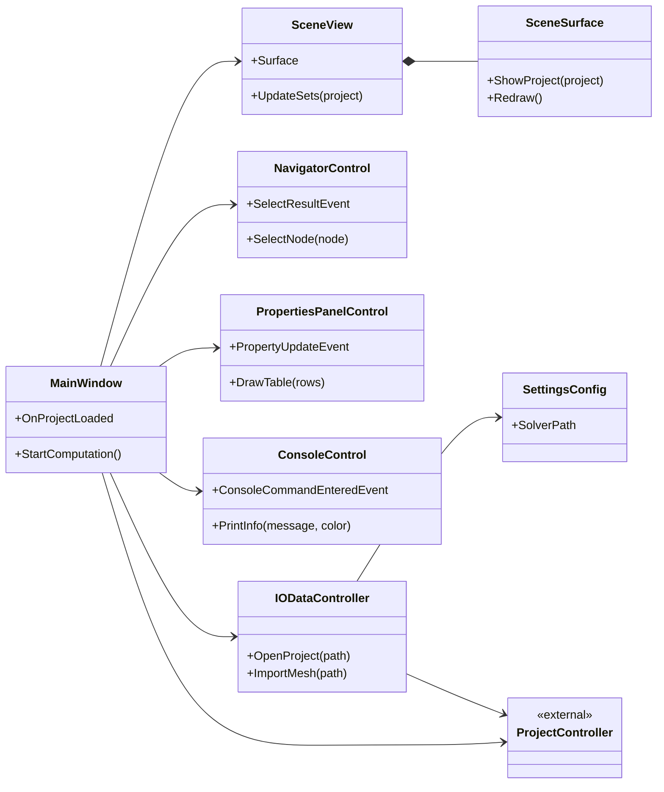

# BazisGUI

BazisGUI — графический клиент для подготовки расчётной модели, запуска CAE-расчёта и просмотра результатов на базе [BazisCORE](https://github.com/ONEGOCH/ModelSolution/blob/Master_dev/BazisCore.sln). Основное приложение — `BazisGUI.Avalonia`. Прежний клиент `BazisGUI.Win` остаётся в решении и поддерживается. Численный расчёт выполняет отдельный решатель, путь к которому задаётся в настройках приложения.

## Возможности

- Создание, открытие и сохранение проектов `.bpf`/`.bpf2`, импорт CAD и сетки.
- Работа с геометрией, сеткой, физическими задачами, свойствами и граничными условиями.
- Отображение модели и выбор видимых объектов в трёхмерной сцене.
- Формирование инструкций расчёта, запуск и остановка внешнего решателя.
- Просмотр полей результатов, графиков и анимации.

Наличие команды в интерфейсе не означает поддержки любого формата или физической задачи. Реализованные пути и их ограничения перечислены в [каталоге функций](Documents/Features.md).

## Состав решения

| Проект | Назначение |
| --- | --- |
| [BazisGUI.Avalonia](BazisGUI.Avalonia/BazisGUI.Avalonia.csproj) | Основной клиент: окно, навигатор, свойства, команды проекта и отображение сцены |
| [BazisGUI.SceneCore](BazisGUI.SceneCore/BazisGUI.SceneCore.csproj) | Общие для двух клиентов камера, ввод, OpenGL-отрисовка, слои и геометрический выбор |
| [BazisGUI.Win](BazisGUI.Win/BazisGUI.Win.csproj) | Поддерживаемый прежний клиент на Windows Forms |
| [BazisGUI.MasterInterface](BazisGUI.MasterInterface/BazisGUI.MasterInterface.csproj), [UserControlsEx](UserControlEx/UserControlsEx.csproj) | Компоненты прежнего клиента |
| [ProjectConverter](ProjectConverter/ProjectConverter.csproj) | Вспомогательное приложение для Windows |
| [InstallerAction](InstallerAction/InstallerAction.csproj), [Setup](Setup/Setup.vdproj) | Компоненты установщика Windows |
| [BazisGUI.SceneCore.Tests](BazisGUI.SceneCore.Tests/BazisGUI.SceneCore.Tests.csproj), [BazisGUI.Avalonia.Tests](BazisGUI.Avalonia.Tests/BazisGUI.Avalonia.Tests.csproj), [BazisGUI.Win.Tests](BazisGUI.Win.Tests/BazisGUI.Win.Tests.csproj) | Тестовые проекты |

Инженерные данные и операции над ними предоставляет BazisCORE: геометрия, модель и сетка, проектные свойства и условия, препроцессор и постпроцессор. `BazisGUI.SceneCore` получает координаты отображаемых объектов через собственные структуры и не зависит от пакета `Model`; применение выбора к проекту остаётся в GUI. Связи компонентов подробнее показаны в [архитектуре решения](Documents/Architecture.md).

## Диаграмма классов BazisGUI.Avalonia

Ниже показаны основные классы оболочки и их связи. Полная схема с событиями, методами и дочерними диаграммами находится в [BazisGUI.Avalonia.mdpuml](BazisGUI.Avalonia/Documents/BazisGUI.Avalonia.mdpuml).



## Требования и запуск

Для сборки основного клиента нужен .NET SDK 8 и доступ к NuGet-пакетам из файлов проектов. В решении также используются библиотеки из каталога `Libs`. Для отображения сцены требуется графическое окружение с совместимым OpenGL-контекстом: [точка входа BazisGUI.Avalonia](BazisGUI.Avalonia/Program.cs) настраивает WGL на Windows и GLX/EGL на Linux. CAD-операциям нужна совместимая нативная библиотека Gmsh (`.dll` на Windows или `.so` на Linux). Для запуска расчёта нужно указать путь к исполняемому решателю в настройках приложения.

### Запуск решателя

При команде запуска `BazisGUI.Avalonia` сохраняет проект, проверяет наличие файла проекта и связанных баз материалов и функций. Затем `PreProc.WriteInstructions` записывает файлы задач в `InputData` и командный файл `ComputationData/computation.tcf`. GUI запускает исполняемый файл по пути `SolverPath`, передаёт ему путь к `computation.tcf` единственным аргументом и устанавливает рабочим каталогом каталог проекта. Остановка завершает дерево процесса; в интерфейсе можно проверить его состояние и код завершения ([StartStopConp.cs](BazisGUI.Avalonia/Shell/Methods/Comp/StartStopConp.cs)).

Решатель может быть любой реализации. Для прямого запуска из GUI он должен понимать переданный командный файл и создавать результаты в формате базы данных, доступном компоненту `ResultDB` BazisCORE; альтернативный решатель может преобразовывать свой вывод в этот формат. Сейчас `BazisGUI.Avalonia` открывает файлы результатов `.db` и проверяет наличие таблицы `nodes` со значениями времени `Time` ([ResultsMainMenuEvents.cs](BazisGUI.Avalonia/Shell/Methods/Results/ResultsMainMenuEvents.cs)). Совместимое хранение результатов позволяет использовать постпроцессор BazisCORE для их просмотра.

Из корня репозитория соберите и запустите основной клиент:

```powershell
dotnet build BazisGUI.Avalonia/BazisGUI.Avalonia.csproj
dotnet run --project BazisGUI.Avalonia/BazisGUI.Avalonia.csproj
```

На Linux в [проекте BazisGUI.Avalonia](BazisGUI.Avalonia/BazisGUI.Avalonia.csproj) предусмотрены конфигурации `Debug-Linux` и `Release-Linux` с идентификатором среды `linux-x64`:

```bash
dotnet build BazisGUI.Avalonia/BazisGUI.Avalonia.csproj -c Debug-Linux
dotnet run --project BazisGUI.Avalonia/BazisGUI.Avalonia.csproj -c Debug-Linux
```

Проверка отдельных частей решения:

```powershell
dotnet test BazisGUI.SceneCore.Tests/BazisGUI.SceneCore.Tests.csproj
dotnet test BazisGUI.Avalonia.Tests/BazisGUI.Avalonia.Tests.csproj
```

`BazisGUI.Win`, `BazisGUI.Win.Tests`, `BazisGUI.MasterInterface` и `ProjectConverter` используют `net8.0-windows`. Проект `UserControlsEx` использует .NET Framework 4.8, а `Setup` — проект установщика Visual Studio. Поэтому сборку всего [BazisGUI.sln](BazisGUI.sln) следует рассматривать отдельно от сборки основного клиента.

## Документация

- [Бизнес-задачи](Documents/BusinessTasks.md), [функции и ограничения](Documents/Features.md), [архитектура](Documents/Architecture.md), [пути реализации](Documents/Implementation.md).
- [Основные потоки BazisGUI.Avalonia](BazisGUI.Avalonia/Documents/Overview.md) и [диаграммы классов BazisGUI.Avalonia](BazisGUI.Avalonia/Documents/BazisGUI.Avalonia.mdpuml).
- [Основные потоки BazisGUI.Win](BazisGUI.Win/Documents/Overview.md) и [диаграммы классов BazisGUI.Win](BazisGUI.Win/Documents/BazisGUI.Win.mdpuml).
- [Диаграммы BazisGUI.SceneCore](BazisGUI.SceneCore/Documents/BazisGUI.SceneCore.mdpuml).

## Лицензия

Условия распространения приведены в [LICENSE.txt](LICENSE.txt): GNU Affero General Public License v3.
